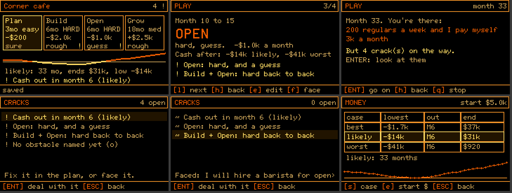

# Projector for AREA512

**Play your ideas forward.** A pocket mental simulator for the
[AREA512](https://github.com/engneer-hamachan/area512) OS on the M5Stack Cardputer ADV. You describe an
idea in a few one-line answers, lay it out as stages, and play it forward month by month. The app
does the arithmetic and points out the **cracks**: where the money runs out, where hard stretches
pile up, what you're only assuming. You fix each one, or *face* it with your own If-Then. When
nothing is left unanswered, **the projection holds**: Projector replays the idea through to your
own picture of success and your own reason why.

The hand-off to Harness (the execution app, not built yet) is designed but deliberately not in the
UI: docs/PROMOTION_FORMAT.md is the agreed file format for when Harness exists.

It is the planning half of the system that [brain-harness](https://github.com/emu-commits/brain-harness)
(GoalGraph, for the web) began. It is built to the *Harness Conceptual Contract* v0.1. The app never
suggests ideas, words or numbers: it asks, and it calculates.

## Install

Copy `dist/projector/` (from a release, or `./build.sh`) to the card at
`/Area512_data/home/ai/projector/` (any folder works). In Filer, select the folder and press
`R`. Copy the whole folder: the `ovl/` subfolder is part of the app. Data lives in
`/Area512_data/data/projector/`.

**Agenda** (`dist/agenda/`) is AREA512's Scheduler, forked onto the same keys: arrows everywhere
(`Fn`+arrow no longer jumps a month), events you can edit, a time field, an agenda list, and
the month beside the day on TERM512. Copy it to `/Area512_data/home/ai/agenda/`; it copies
Scheduler's events the first time. See [forks/agenda/UPSTREAM.md](forks/agenda/UPSTREAM.md).

**Home** (`dist/home/`, new for 1.0) is the suite's first screen: a row of app icons with each
app's files under its icon, after the Psion Series 3. Copy it to `/Area512_data/home/ai/home/`
and add `default=app:/home/ai/home` to `/Area512_data/etc/ui` to start on it. It finds the apps
on the card and writes the list every app's `Tab` › Apps menu reads. Switching apps needs
AREA512 newer than v2.7 (`Area512.run_next`).

## How it works

- **[docs/PLAN.md](docs/PLAN.md)**: the design. Psychology → mechanism, the crack rules, the
  projection maths, screens and keys, and what was cut and why.
- **[docs/PROMOTION_FORMAT.md](docs/PROMOTION_FORMAT.md)**: Projector's idea file, and the designed (not yet
  wired) Projector → Harness file format (the contract's open question §11).
- **[apps/projector/README.md](apps/projector/README.md)** and
  **[apps/home/README.md](apps/home/README.md)**: the short help that ships on the card.
- **[docs/UI.md](docs/UI.md)** and **[docs/APPS_FORMAT.md](docs/APPS_FORMAT.md)**: the keys every
  app shares, and the files the apps switch through.
- **[docs/LIFECYCLE_SHELL.md](docs/LIFECYCLE_SHELL.md)**: feedback on an AREA512 shell built
  around the capture → shape → do → review lifecycle (not built).
- **[docs/TERM512.md](docs/TERM512.md)**: why Projector runs in a 240×135 window on TERM512, and
  the firmware change that would let it go full screen.
- **[docs/PLAN_V1.md](docs/PLAN_V1.md)**: the plan for the next major version: full screen, app
  switching, a Psion Series 3 style UI grammar, and forks of the bundled productivity apps.
- **[docs/upstream/AREA512_ISSUES.md](docs/upstream/AREA512_ISSUES.md)**: issues to file on AREA512
  (full screen on TERM512, app hand-off, uptime), ready to paste.

## Build and test

The Ruby forks need an [AREA512](https://github.com/engneer-hamachan/area512) checkout with its
host `picorbc` built, at `~/area512` (or set `AREA512`), and `ruby` for `tests/rsim.rb`.
You need [area512-factory](https://github.com/emu-commits/area512-factory) checked out at
`~/area512-factory` (or set `AREA512_FACTORY`), with its `./setup.sh` run (`tests/fw.py` needs its `emu/fwrun.mjs` with `--dump`).

    ./build.sh               # lib/py/ + apps/<app>/ -> dist/projector/, dist/home/ (manifest, .mpy, ovl/, icons/)
    tests/sim.py             # key-script scenarios in a512sim (AREA512's MicroPython + API mocks);
                             # home_* run Home, and check the files it writes and the app it hands off to
    tests/sim.py --both      # the same on a Cardputer and on TERM512 (full screen, 320x240);
                             # agenda_* run the Ruby fork under CRuby (tests/rsim.rb)
    tests/fw.py full_arc     # the same scenario on the OFFICIAL firmware, headless, with screenshots
                             # and the card's files copied back to tests/.fw/data/
    tests/fw.py home_open --term512   # Home and Projector on the TERM512 build (which has run_next)

Layout: `apps/<app>/` (MicroPython apps: `main.py`, overlays in `ov/`), `lib/py/` (shared by
them: MINIMUM has no `import`, so `build.sh` puts these files in front of each app's
`main.py`), `forks/` (the PicoRuby forks of the bundled apps), `tools/`, `tests/`, `docs/`.

### Memory (the hard part)

AREA512 gives MicroPython about 53 KB of heap on a Cardputer ADV. That figure is measured on the
official firmware, and it can't grow once the display and SD buffers exist. Three things make the
app fit:

1. **`main.manifest`, not `main.mpy`.** Launched as `main.mpy`, the firmware holds the whole
   bytecode file in RAM for the entire run, *and* sizes the heap after reading it. Through a
   manifest, the heap is sized first and each entry's buffer is freed once it has run.
2. **Overlays.** Only the core (engine, storage, question screens, library, strip, play,
   cracks) is resident: `core.mpy`, ~15.5 KB. The rest ships as source in `ovl/`: new idea,
   stage editor, vision, assumptions, money, holds/judgment, help. `App.ov` compiles an overlay
   into the globals, runs it, then deletes exactly the names it added. Two measured limits
   shape the files:
   - the compiler needs ~13× the source it compiles at once (a 4 KB file: 25 KB), so
     `tools/ovl.py` writes **one file per top-level def** and refuses any def over 520 bytes;
   - reading a whole overlay needs one contiguous string, which a fragmented heap doesn't have,
     so each def is read and compiled on its own.
   Resident code went from ~50 KB to ~32 KB.
3. **Files in 900-byte parts.** The SD API has no append, so whatever is written is one string
   and needs one contiguous run of heap. A long session leaves the heap fragmented: 17 KB free
   can still hold no 3 KB block. So every file is written as `<file>`, `<file>.1`, ... of at
   most 900 bytes each, and a 1 KB spare block (taken while the heap is clean) is released
   around each part. Running out of memory on save, open or overlay load gives a message,
   not a crash.

The hidden key `%` shows `free (in 1 KB blocks) of total` heap on any screen.

Language level: AREA512's MicroPython is built at MINIMUM. No `import`, slicing, f-strings,
`min`/`max` or `json`. The app also draws its own question screens, because `Widget.input` blanks
the screen down to one label line.

MIT licensed.
